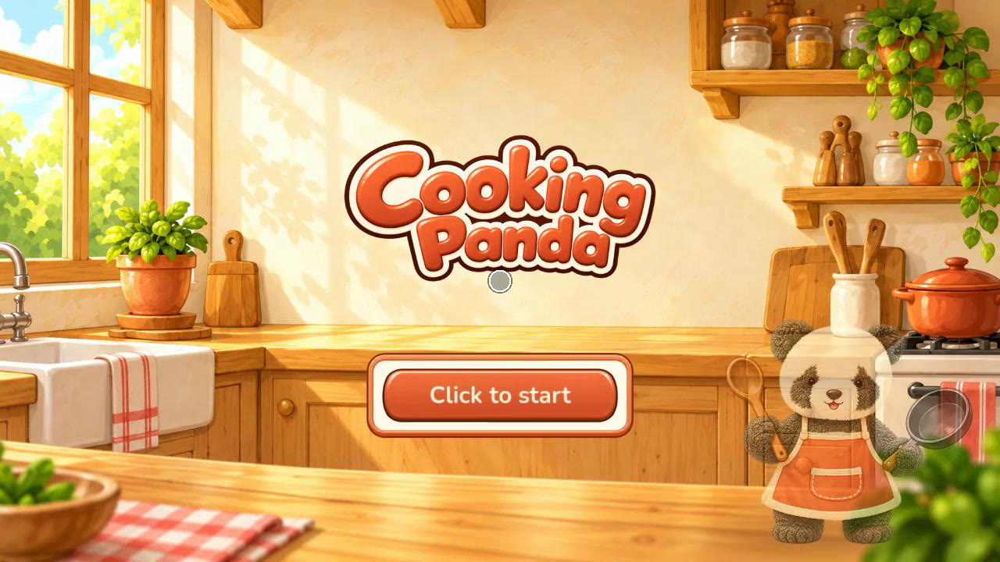
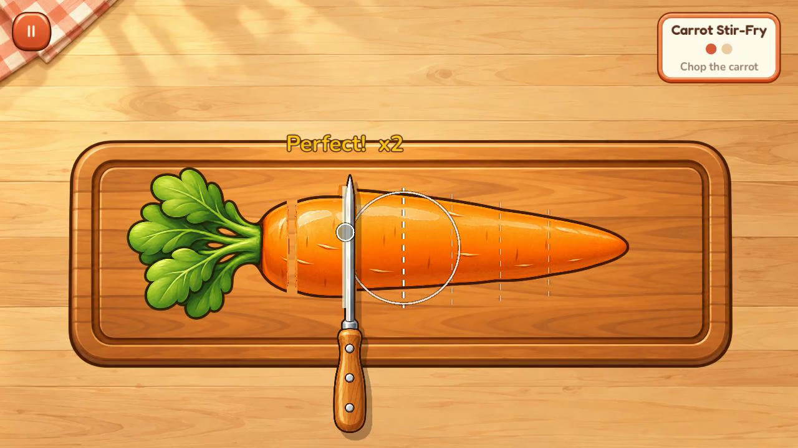
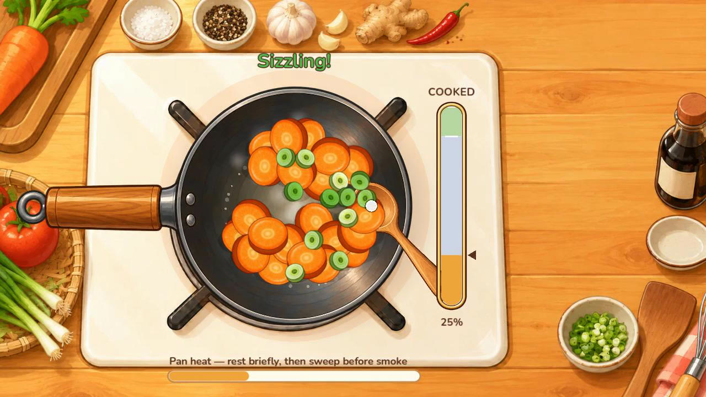
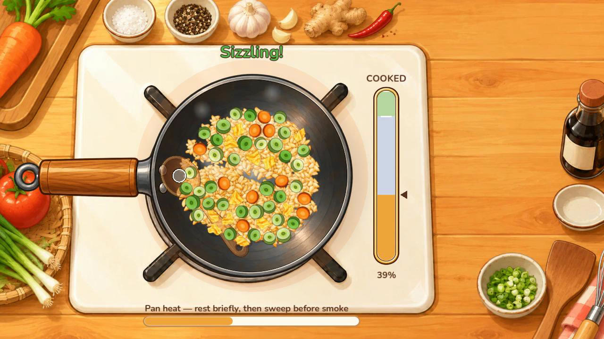
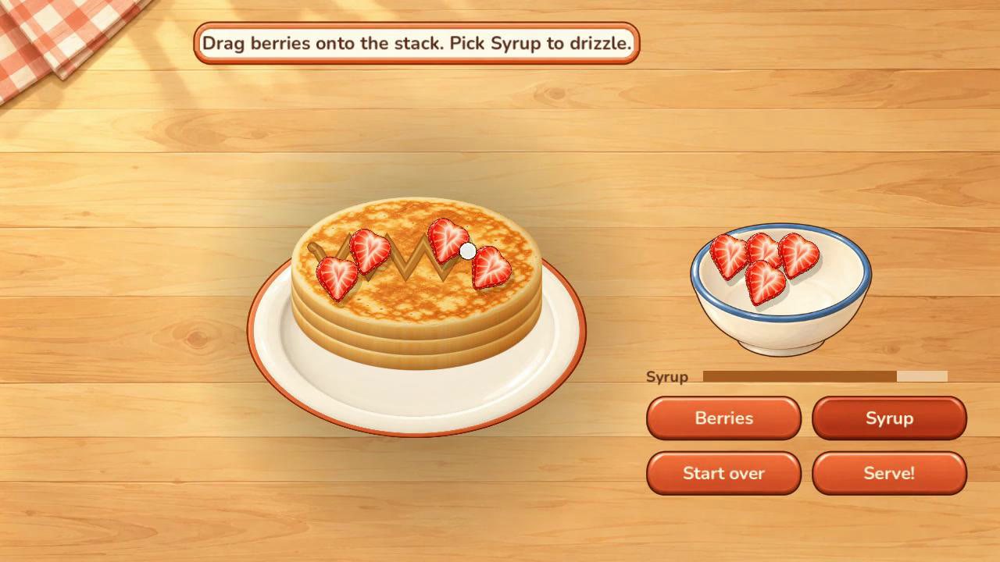
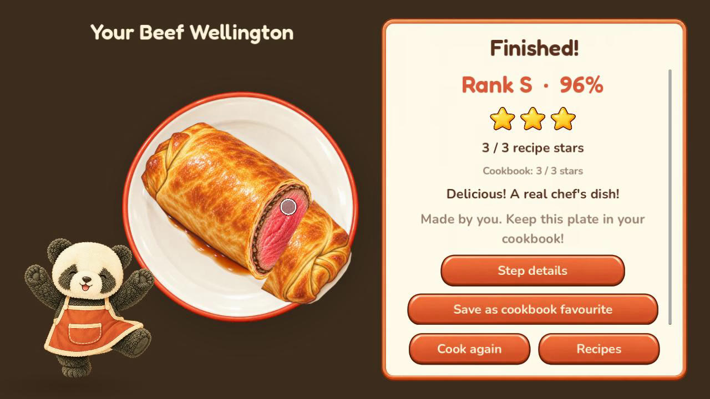

# Cooking Panda

A cozy little cooking game you play in the browser. Cook dishes with the panda chef, one quick hands-on step at a time: chop, crack, whisk, stir-fry, pour, sear, wrap and decorate. Each step gets stars, and each dish gets a rank.

## ▶ Play: https://onetrickollie.github.io/cooking-panda-play/

Nothing to install. It plays best in a desktop browser with a mouse. Phones are supported in landscape but are still being tested.

## Recipes

- **Carrot Stir-Fry**: start here
- **Tomato & Egg Stir-Fry**
- **Egg Fried Rice**
- **Beef Wellington**: sear, wrap, bake and slice
- **Strawberry Pancakes**: a sweet treat with pouring, flipping and decorating

Cook a dish to unlock the next ones. The panda shows each move the first time you meet it. Your best results and favourite plates go into the cookbook, saved in your browser.

## Screenshots

| | |
|---|---|
|  |  |
|  |  |
|  |  |

## Tips

- In the wok: sweep the spoon through the food, let it sizzle for a moment, then sweep again before it smokes.
- Press **Esc** or **P** to pause. From the pause menu you can restart a step or leave the recipe.
- **Practice a step** on the recipe picker replays a single move without affecting your stars.

This repository holds only the published web build and updates automatically. Made with [Godot](https://godotengine.org/). Sound credits are under **Settings & credits** in the game.
